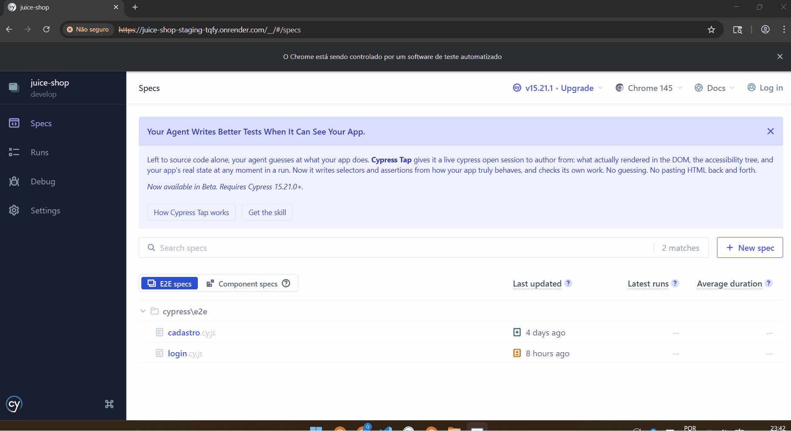
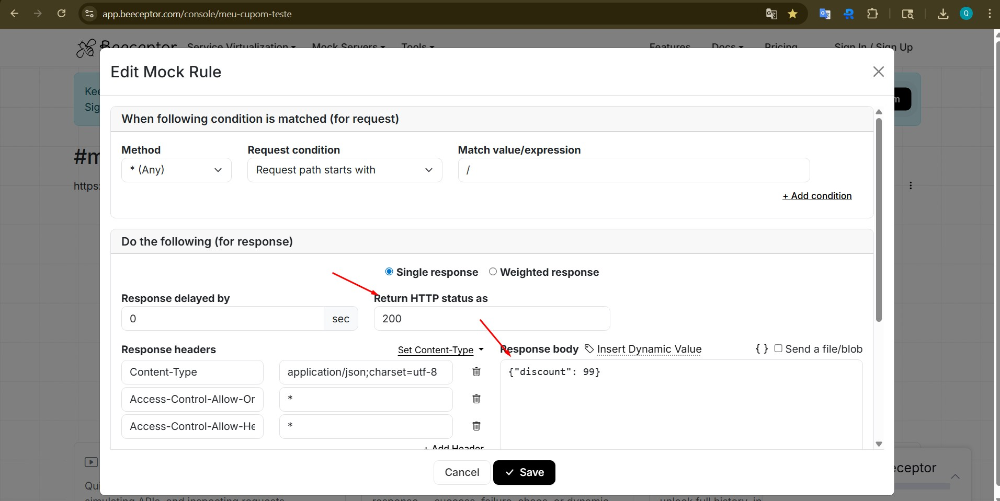
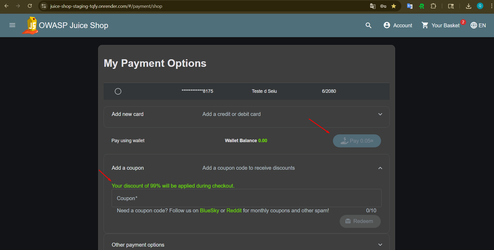
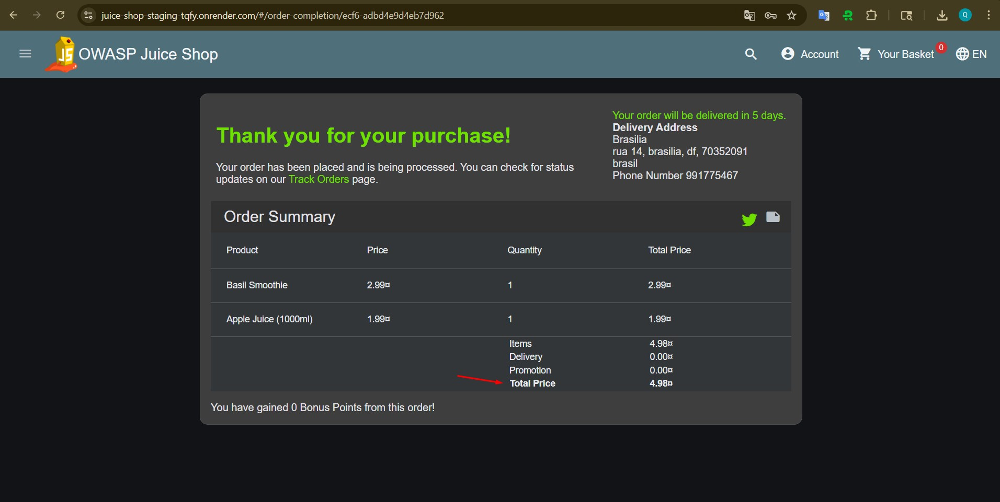

# 🧪 Laboratório Prático de Testes de Software (API, E2E & Mocking) - OWASP Juice Shop

Este repositório documenta o meu estudo e aplicação prática de **Garantia de Qualidade (QA)** e **Automação de Testes**. O objetivo principal deste laboratório foi construir, do zero, um fluxo completo de testes para a aplicação **OWASP Juice Shop**, cobrindo desde a camada de API até a interface web (E2E) e simulação de tráfego/mocking.

> A aplicação alvo roda em ambiente de **Staging** no Render: https://juice-shop-staging-tqfy.onrender.com

---

## 📊 Cobertura de Testes

| Camada | Ferramenta | Escopo | Volume |
| :--- | :--- | :--- | :--- |
| **API** | Postman + Newman | Cadastro, login (JWT), consulta e listagem de usuários + caminhos negativos | 6 requisições · 16 validações |
| **API** | Cypress (`cy.request`) | Produtos e carrinho de compras, incluindo acesso sem token | 2 testes |
| **E2E (Interface)** | Cypress | Cadastro e login pela tela, com caminho feliz e negativo | 4 testes |
| **Exploratório / Segurança** | Requestly, Beeceptor, DevTools | Manipulação de resposta no checkout (cupom de 99%) | Estudo de caso |

---

## 📌 Visão Geral do Laboratório

1. **Testes de API (Postman, Newman e Postman CLI):**
   * **Fluxo Encadeado de Dados:** scripts em JavaScript capturam dados dinâmicos do cadastro (`userId`, `email_dinamico`) e os reutilizam nas chamadas de login e consulta.
   * **Autenticação:** captura automática do Token JWT gerado no login para autorizar as requisições protegidas (*Bearer Token*).
   * **Caminho Feliz:** cadastro (201), login (200 + token), consulta pelo id e listagem de usuários.
   * **Caminho Negativo:** login com senha incorreta e com e-mail inexistente, validando status 401, **mensagem de erro genérica** (proteção contra enumeração de usuários) e ausência de token.
   * **Validações de Segurança:** a resposta da API não expõe a senha do usuário.

2. **Testes de Interface / E2E (Cypress):**
   * Automação dos fluxos de **cadastro** e **login** de usuários pela tela.
   * Usuários de teste criados via API antes dos testes de tela (sem credenciais fixas no código).
   * Validação de regras de negócio: senhas divergentes exibem erro e **bloqueiam o botão de cadastro**; login inválido exibe mensagem e mantém o usuário na tela.
   * Validação de sessão: após o login, o token é salvo no navegador (`localStorage`).

3. **Testes de API com Cypress:**
   * Fluxo completo de **listar produtos → autenticar → adicionar ao carrinho → conferir o carrinho**.
   * Teste de segurança: inclusão no carrinho **sem token JWT** deve ser recusada (401/403).

4. **Interceptação de Tráfego & Mocking de API (Requestly + Beeceptor):**
   * **Manipulação de Resposta no Front-end:** redirecionamento local para simular respostas customizadas em JSON (`{"discount": 99}`).
   * **Validação de Regra de Negócio (Checkout):** teste de resiliência e integridade para garantir que, manipulando respostas no lado do cliente (*client-side*), o servidor real (*back-end*) continue cobrando os valores corretos.

5. **Ambiente e Execução (Render, Docker, UptimeRobot e GitHub Actions):**
   * Aplicação alvo implantada em ambiente de **Staging** na nuvem pelo **Render**.
   * Ambiente monitorado com **UptimeRobot**, para manter a aplicação disponível (o plano gratuito do Render "dorme" por inatividade).
   * Testes executados localmente via **WSL2 (Ubuntu)** e em containers com **Docker**.
   * Execução automática dos testes de **API (Newman)** e **E2E (Cypress)** via **GitHub Actions** a cada push e Pull Request na branch `main`.

6. **IA no Workflow de QA (Human-in-the-Loop):** uso de assistentes de IA (Cursor, Roo Code + Gemini e Claude) para estruturar scripts, refatorar e documentar, **sempre com revisão e decisão humana**. Exemplo real: uma sugestão automática de "corrigir a autenticação" num teste negativo foi recusada, porque o status 401 era exatamente o comportamento esperado.

---

## 🛡️ Achados de QA

| Achado | Tipo | Como foi identificado | Resultado |
| :--- | :--- | :--- | :--- |
| Teste de consulta só passava por usar um **token antigo salvo** no arquivo de ambiente | Bug no teste (dependência oculta) | Ao remover o token do repositório, a consulta passou a retornar 401 | Ordem corrigida: o login agora roda antes da consulta |
| **Token JWT exposto** no arquivo de ambiente versionado | Segurança / boas práticas | Revisão do repositório | Valores sensíveis removidos do arquivo versionado |
| Um cliente comum consegue **listar todos os usuários**, inclusive administradores | Segurança (*Broken Access Control*) | Teste de listagem com token de cliente | Documentado (falha proposital do Juice Shop) |
| O token JWT carrega o **hash da senha** do usuário | Segurança (exposição de dados) | Decodificação do token em jwt.io | Documentado (falha proposital do Juice Shop) |
| Timeouts (`ESOCKETTIMEDOUT`) em todas as rotas de login | Ambiente (servidor sobrecarregado) | Comparação com execução anterior bem-sucedida | Diagnóstico de ambiente, e não de teste; resolvido com reinício do serviço e uso de `--timeout-request` |

---

## ✅ Boas Práticas Aplicadas

- **Dados dinâmicos** (`$timestamp` e `Date.now()`): cada execução cria seus próprios dados, sem conflito com execuções anteriores.
- **Custom Commands no Cypress** (`cy.abrirTelaDeLogin`, `cy.criarUsuarioViaApi`, `cy.apiLogin`): passos repetidos escritos uma única vez (DRY).
- **Sem `{force: true}`**: os testes interagem com a tela como um usuário real; campos cobertos pelo rótulo (*Angular Material*) são clicados antes da digitação.
- **Sem credenciais fixas** no código de teste.
- **Sem `Cypress.env()` para dados sensíveis** (`allowCypressEnv: false`): token e carrinho são repassados diretamente entre os comandos com `cy.wrap()`.
- **Timeout por requisição** no Newman (`--timeout-request 30000`) para o pipeline não travar se o servidor demorar.
- **Segredos fora do repositório**: o arquivo de ambiente versionado não guarda token, e-mail ou id de execuções anteriores.

---

## 🛠️ Ferramentas Utilizadas

- **Testes de API:** Postman, Postman CLI, Newman
- **Testes E2E:** Cypress (JavaScript)
- **Interceptação & Mocking:** Requestly, Beeceptor, Chrome DevTools
- **Gerenciamento de Pacotes:** Node.js (v22) / NPM
- **Ambiente & Infraestrutura:** WSL2 (Ubuntu), Docker, Render (Staging), UptimeRobot
- **Integração Contínua:** GitHub Actions
- **Versionamento:** Git e GitHub
- **Assistentes de IA & Produtividade:** Cursor, Roo Code + Gemini, Claude (sempre com revisão humana)

---

## ⚙️ Pré-requisitos e Instalação

- **Node.js:** versão 22 ou superior recomendada.

Para instalar as dependências do projeto localmente, garantindo compatibilidade com a aplicação:

    npm install --legacy-peer-deps

---

## 🚀 Como Executar os Testes de API (Newman)

Para rodar a coleção de testes de API no terminal, apontando para o ambiente de Staging na nuvem:

    npx newman run tests/juice-shop.postman_collection.json -e tests/juice-shop.postman_environment.json --timeout-request 30000

---

## 💻 Como Executar os Testes do Cypress

### Executar todos os testes no terminal (modo headless):

    npx cypress run

### Executar um arquivo específico no terminal:

    npx cypress run --spec "cypress/e2e/cadastro.cy.js"

### Abrir a interface gráfica do Cypress:

    npx cypress open

---

## 📹 Demonstração dos Testes de Interface (Cypress)

Abaixo estão as demonstrações visuais da execução automatizada dos cenários E2E na interface do sistema:

### 1. Fluxo de Cadastro de Usuário (`cadastro.cy.js`)

### 2. Fluxo de Login (`login.cy.js`)

---

## 🔬 Estudo de Caso: Mocking de API e Validação no Checkout

Além da automação tradicional, executei um teste de resiliência e integração simulando a injeção de um cupom com 99% de desconto por meio do redirecionamento de tráfego.

### 🎯 Objetivos
- Verificar como o **Front-end** reage ao receber retornos fora do padrão em formato JSON (`{"discount": 99}`).
- Validar se o **Back-end** recalcula os dados no banco durante o checkout, impedindo fraudes financeiras geradas no cliente.

### 📸 Evidências Práticas

#### 1. Configuração do Mock de Resposta (Beeceptor + Requestly)

#### 2. Comportamento do Front-end (Desconto de 99% exibido na interface)

#### 3. Validação de Segurança no Back-end (Cobrança do valor integral no Checkout)

### 📊 Resultados do Teste

| Etapa | Comportamento Observado | Diagnóstico de QA |
| :--- | :--- | :--- |
| **Aplicação do Cupom (Front-end)** | O Front-end aceitou a resposta mockada do Beeceptor e exibiu a mensagem de 99% de desconto aplicado. | **Tratamento da Resposta no Front-end:** a interface exibe o que recebe da API, sem validar o valor por conta própria. |
| **Checkout Final (Back-end)** | Ao finalizar a compra, o servidor recalculou o carrinho a partir do banco e cobrou o valor original do produto. | **Sucesso em Segurança e Regra de Negócio:** o servidor ignora o estado visual do cliente e mantém a integridade da transação. |

---

## 📚 Aprendizados e Desafios Resolvidos

- **Tratamento de Dados Dinâmicos:** variáveis de tempo (`$timestamp` e `Date.now()`) nos testes de API e E2E evitam testes quebrados por dados já existentes na base.

- **Encadeamento de Requisições:** uso de variáveis de ambiente (`pm.environment.set`) para repassar o token de autenticação entre endpoints, e atenção à **ordem de execução** (o login precisa vir antes das rotas protegidas).

- **Erro de teste x erro de ambiente:** diferenciar uma falha de validação de uma falha de infraestrutura (`ESOCKETTIMEDOUT`) antes de alterar qualquer teste.

- **Investigação do `{force: true}`:** ao removê-lo, o Cypress mostrou que o rótulo dos campos (*Angular Material*) cobria o input. A solução foi imitar o usuário (clicar no campo antes de digitar), em vez de forçar a interação.

- **Mocking de APIs e Interceptação de Rede:** uso do Requestly e do Beeceptor para isolar testes de interface e validar regras de negócio no Back-end sem alterar o código da aplicação.

- **Automação no Pipeline de CI/CD:** GitHub Actions (Node 22) prepara o ambiente, gerencia dependências legadas com `--legacy-peer-deps` e dispara as suítes do Newman e do Cypress a cada Pull Request e integração na branch `main`.

---

## 📫 Contato

- **LinkedIn:** https://www.linkedin.com/in/felipe-almeida-soares/
- **GitHub:** https://github.com/testerqafelipe
